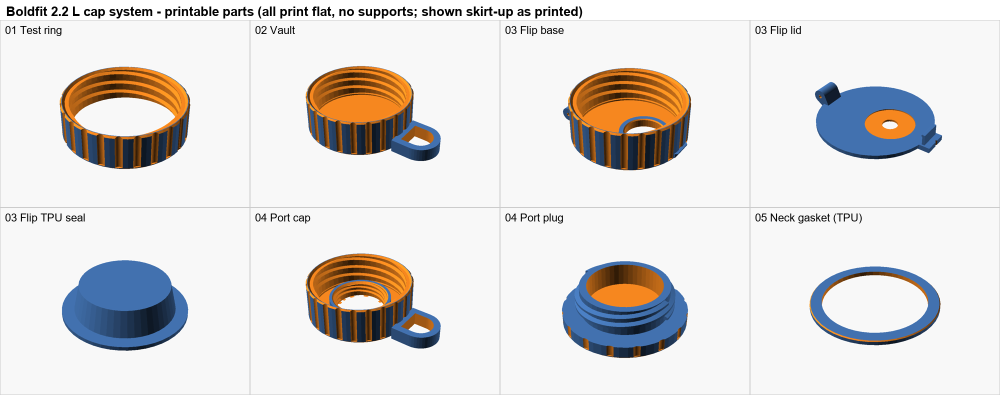

# Boldfit 2.2 L Gallon – 3D-printable replacement cap

Parametric OpenSCAD cap system for the [Boldfit 2.2 L Gym Gallon bottle](https://www.amazon.in/dp/B0CNRSGV7Q).
No official thread spec exists, so you measure the neck once, enter the numbers in
[`scad/params.scad`](scad/params.scad), and every design regenerates to fit.

> [!WARNING]
> The STLs in [`stl/`](stl/) are built from **placeholder neck dimensions**. Measure your bottle
> and print the test ring before printing a full cap.

## Designs

| Design | Description | Files |
|--------|-------------|-------|
| **Test ring** | Threaded skirt only. ~12 min print to check thread fit. | [`01_test_ring`](scad/01_test_ring.scad) |
| **Vault** | Plain leak-proof storage cap with grip and strap loop. | [`02_vault_cap`](scad/02_vault_cap.scad) + neck gasket |
| **Flip** | Flip-top drinking lid, filament-pin hinge, snap latch, removable TPU plug seal. | [`03_flip_*`](scad/) + neck gasket |
| **Port** | Cap with a 30 mm drinking port and a quarter-turn screw plug. No hinges or snaps. | [`04_port_*`](scad/) + neck gasket |

All parts print flat without supports. Every seal lifts out and there are no blind pockets, so
everything can be washed. See the [cross-sections](preview/sections_2d.png) for how each seals.

## Quick start

1. **Measure** the bottle neck with calipers and enter the values in [`params.scad`](scad/params.scad) (table below).
2. **Render** with [OpenSCAD](https://openscad.org/downloads.html). A 2024+ development snapshot with the
   Manifold backend renders each part in about a second. Open a `.scad` file, press F6, then F7 to export.
   On Windows, [`render_all.cmd`](render_all.cmd) regenerates every STL at once.
3. **Print the test ring** and screw it on. Adjust `radial_clear` by ±0.1 until it turns smoothly.
4. **Print** your chosen cap and gaskets.

### Neck measurements

| Parameter | How to measure |
|-----------|----------------|
| `neck_major_d` | Outside diameter across the thread crests |
| `neck_minor_d` | Outside diameter of the bare neck between threads |
| `mouth_id` | Inside diameter of the opening |
| `neck_height` | Top lip down to the shoulder ring |
| `thread_pitch` | Crest-to-crest distance, measured along the bottle axis |
| `thread_starts` | Number of separate thread ridges starting at the lip (usually 1 or 2) |
| `thread_turns` | Laps one ridge makes around the neck |
| `thread_start_z` | Top lip down to the start of the first ridge |
| `thread_crest_w` | Width of the flat top of a ridge |
| `thread_root_w` | Width of a ridge where it meets the neck |

Check: `thread_pitch × thread_starts` should equal how far one ridge climbs per lap.

### Test ring troubleshooting

| Symptom | Fix |
|---------|-----|
| Too tight or won't start | Increase `radial_clear` by 0.1 |
| Loose or wobbly | Decrease `radial_clear` by 0.1 |
| Binds halfway | Re-measure `thread_pitch` and `thread_starts` |
| Stops before sealing | Re-measure `thread_start_z` and `thread_turns` |

## Print settings

| Part | Material | Settings |
|------|----------|----------|
| Caps, lid, plug | PETG | 0.16–0.2 mm layers, 6 walls, 100% infill |
| Gaskets, Flip plug seal | TPU 95A | 0.2 mm layers, 100% infill, 20 mm/s |

If you have no TPU, use the gasket STL as a template to cut 2 mm food-grade silicone sheet.
The Flip hinge pin is 26 mm of 1.75 mm filament with both ends melted flat.

## Notes

- Right-hand threads throughout.
- Fit and seal tuning values are commented at the top of [`params.scad`](scad/params.scad) and [`parts.scad`](scad/parts.scad).
- Printed parts are not food-contact certified. Wash before use and replace gaskets when they discolour.
